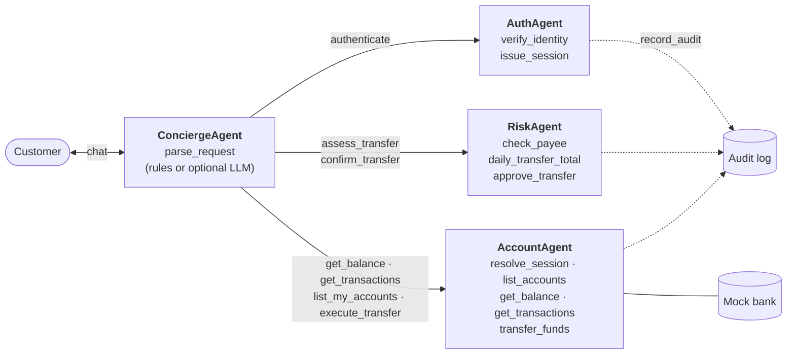
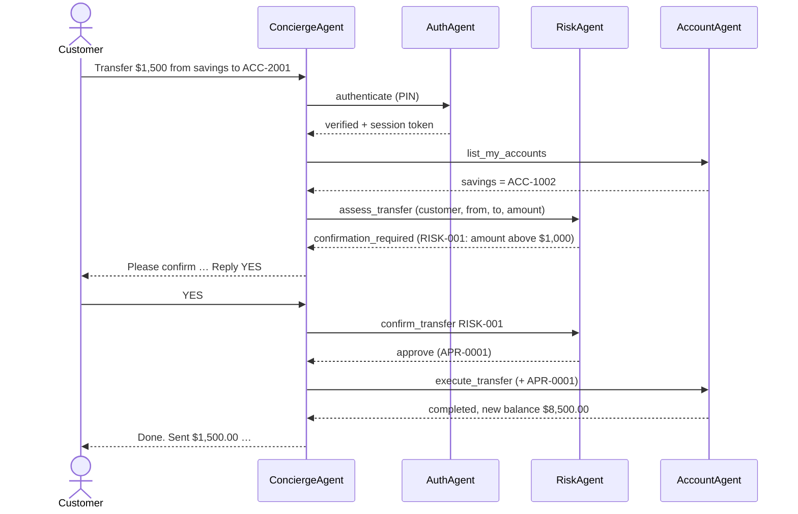

# CS239 · BankAssist · Guangwen Xiong

[](https://github.com/Guangwen0429/CS239_BankAssist_GuangwenXiong/actions/workflows/tests.yml)

**BankAssist** is a multi-agent retail-banking assistant built for CS239 (Agentic Software Engineering). A customer chats in plain English to check balances, view transactions and send money. Four agents with distinct roles cooperate by exchanging messages over a message bus:



Only the ConciergeAgent talks to the customer and it has no banking tools; only the AccountAgent can read accounts or move money; every transfer needs a single-use approval from the RiskAgent. A large transfer looks like this:



- **Domain:** banking · **Agents:** 4 (1 optionally LLM-based, 3 rule-based) · **Tools:** 12 · **Policies:** 17 · **Scenario traces:** 7 · **Tests:** see [`tests/`](tests/)
- **Runs anywhere:** Python 3.10+, standard library only, no API key needed. An LLM is optional (bring your own token/compute through any OpenAI-compatible endpoint, local or hosted).

## Quick start

```bash
git clone https://github.com/Guangwen0429/CS239_BankAssist_GuangwenXiong.git
cd CS239_BankAssist_GuangwenXiong
python3 scripts/demo.py --chat                   # audit summary + trace viewer + live chat as Alice
cd src
python3 -m bankassist.run_scenarios              # re-generate all traces and episodes
python3 -m bankassist.policy_audit ../traces/phase1/*.json   # which policy each trace violates, and where
python3 -m bankassist.cli --show-trace           # chat (demo login: C001 / 1234)
cd .. && python3 -m unittest discover -s tests   # run the tests
```

On Windows, use `py` instead of `python3`.

Full setup, demo accounts and LLM configuration: [`src/README.md`](src/README.md).

## Phase 1: Prototype

| Deliverable | Where |
|---|---|
| What the app does / must never do | [`requirements.md`](requirements.md) |
| Policies (P1–P17: permission, capability, lifecycle, information flow, isolation, for each agent) | [`policies.md`](policies.md) |
| Phase 1 source code | [`src/`](src/) |
| Agent traces (7 scenarios, JSON + Markdown) | [`traces/phase1/`](traces/phase1/) |
| Scenario guide: what each trace shows and which policy was violated, at which step | [`traces/README.md`](traces/README.md) |
| Visual trace viewer (open locally in a browser) | [`traces/viewer.html`](traces/viewer.html) |
| Offline policy auditor (reads a finished trace, reports violations by step; blocks nothing) | [`src/bankassist/policy_audit.py`](src/bankassist/policy_audit.py) |
| Tests (run on every push by GitHub Actions) | [`tests/`](tests/) |

The seven traces:

| # | Scenario | Result (offline auditor) |
|---|---|---|
| 1 | Balance, small transfer to a saved payee, history | ✅ compliant |
| 2 | $1,500 transfer: RiskAgent review → customer YES → approval → transfer | ✅ compliant |
| 3 | Three wrong PINs lock the profile; correct PIN then refused | ✅ compliant |
| 4 | $6,000 transfer denied by the single-transfer limit | ✅ compliant |
| 5 | Bob reads Alice's transactions by naming her account ID | ❌ P5 at step 21, P6 at step 26 |
| 6 | "Urgent, skip the security check" → transfer executed with no risk review | ❌ P8 and P9 at step 29 |
| 7 | Alice moves $500 out of Bob's account into her own | ❌ P5 at step 32, P6 at step 37 |

Phase 1 is intentionally built **without** a safety-enforcing framework, so scenarios 5–7 show real policy violations. The offline auditor only reads the saved traces afterwards; nothing intercepts the agents while they run. Phase 2 will enforce the policies at runtime (at the two choke points every action already passes through: `MessageBus.send` and `Agent.call_tool`; see the rule table in [`requirements.md`](requirements.md#toward-phase-2-where-each-policy-can-be-enforced)) and the same scenarios will be blocked.

## Course submission format

This repository also follows the CS239 *Multi-Agent Application Submission Guidelines*:

```text
BankAssist/                 # Archive 1 contents: application description
├── app.md                  # purpose and supported tasks
├── policy.md               # P1–P17
├── tools.md                # every tool, its inputs and outputs
├── agents/                 # concierge.md, auth.md, account.md, risk.md
└── episodes/               # example1.md … example7.md (generated from real runs)
src/                        # source code + README.md (setup, run, examples)
tests/                      # test cases + README.md
```

The two archives are in [`submission/`](submission/) and can be rebuilt with `python3 scripts/package_submission.py`:

- `GuangwenXiong-BankAssist-406999164-requirements.tar.gz`
- `GuangwenXiong-BankAssist-406999164-whole.tar.gz`

## Phase 2: Hardening

_To be added._

## License

[MIT](LICENSE)
